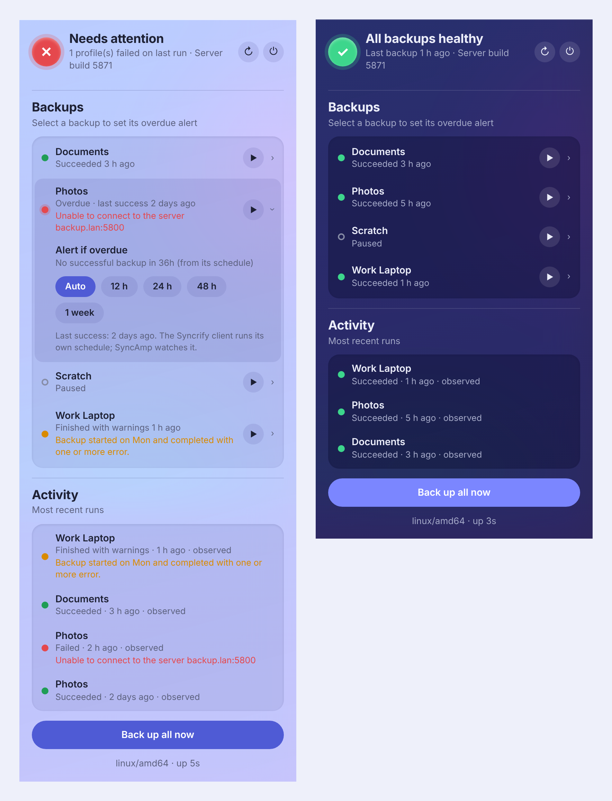

# SyncAmp

[](https://github.com/brielshallouf/SyncAmp/actions/workflows/ci.yml)
[](https://github.com/brielshallouf/SyncAmp/releases)

<p align="center"></p>
<p align="center"><sub>The SyncAmp window with demo data: an overdue backup with its alert settings open (left), and everything healthy (right).</sub></p>

A **client-side companion for [Syncrify](https://web.synametrics.com/) backups** on Windows, macOS and Linux: one app: a notification-area icon that opens its own window, a small background service, and a headless command line that tells you whether this machine's backups are actually healthy, lets you run them on demand, and alerts you when one fails or goes **overdue**.

**Scope.** SyncAmp runs on each machine being backed up and watches that machine's Syncrify client. It does not administer a Syncrify *server* (users, quotas, storage, settings): use Syncrify's own web console for that. Its only server feature is a connection check: "can this machine reach the server, and does it answer like Syncrify?".

SyncAmp is independent of Synametrics. It does **not** reimplement the Syncrify protocol; it drives and observes the official client, so you keep Syncrify's delta engine, encryption and server compatibility. What we know about Syncrify (and what we don't) is in [docs/SYNCRIFY-NOTES.md](docs/SYNCRIFY-NOTES.md).


## Download

| Your system | Download | What you get |
|---|---|---|
| **Windows** 10 / 11 (64-bit) | [**SyncAmp-Setup.exe**](https://github.com/brielshallouf/SyncAmp/releases/download/nightly/SyncAmp-Setup.exe) | **One installer** for everything: the background service, the app (tray icon + its own window), start at login, a Start-menu entry, and a clean uninstall |
| **macOS** 14+ | [**SyncAmp-macos.zip**](https://github.com/brielshallouf/SyncAmp/releases/download/nightly/SyncAmp-macos.zip) | **One app.** It carries its own background service and sets it up the first time you open it |
| **Linux / servers** | [syncamp-linux-amd64](https://github.com/brielshallouf/SyncAmp/releases/download/nightly/syncamp-linux-amd64) · [ARM64](https://github.com/brielshallouf/SyncAmp/releases/download/nightly/syncamp-linux-arm64) | One command-line program that is also the service. Optional desktop icon: [syncamp-app-linux-amd64](https://github.com/brielshallouf/SyncAmp/releases/download/nightly/syncamp-app-linux-amd64) |

The newest build is always here (rebuilt on every push); numbered versions are on the [Releases page](https://github.com/brielshallouf/SyncAmp/releases), and once one exists the same file names work under `.../releases/latest/download/`. Each release has a `SHA256SUMS` file. The programs are **not code-signed**, so Windows SmartScreen and macOS Gatekeeper warn on first run ([how to proceed](docs/GETTING-STARTED.md#first-run-warnings)).

<details><summary>Portable / advanced files</summary>

[syncamp-windows-amd64.exe](https://github.com/brielshallouf/SyncAmp/releases/download/nightly/syncamp-windows-amd64.exe) · [ARM64](https://github.com/brielshallouf/SyncAmp/releases/download/nightly/syncamp-windows-arm64.exe) (service + CLI only) · [syncamp-app-windows-amd64.exe](https://github.com/brielshallouf/SyncAmp/releases/download/nightly/syncamp-app-windows-amd64.exe) (the app alone) · macOS command line: [Apple Silicon](https://github.com/brielshallouf/SyncAmp/releases/download/nightly/syncamp-darwin-arm64) · [Intel](https://github.com/brielshallouf/SyncAmp/releases/download/nightly/syncamp-darwin-amd64). You do not need these if you use the installer or the Mac app.
</details>

## Quick start

- **Windows:** run `SyncAmp-Setup.exe`, then click the SyncAmp icon next to the clock. That's all: no sign-in, no second download. *(If your Syncrify profiles are in your user folder, tick "Let SyncAmp see my Syncrify profiles" in the installer; see [why it is a choice](docs/GETTING-STARTED.md#windows).)*
- **macOS:** unzip `SyncAmp-macos.zip`, drag **SyncAmp** to Applications, open it (right-click → Open the first time).
- **Linux / servers:** `sudo install -m 0755 syncamp-linux-amd64 /usr/local/bin/syncamp && sudo syncamp install && sudo syncamp start && syncamp status`

**[Step-by-step guide for each system, with troubleshooting →](docs/GETTING-STARTED.md)**

## Two modes

The Syncrify client already schedules its own backups (its background service, or Task Scheduler / cron / launchd). So SyncAmp defaults to **monitor** mode and never starts a scheduled backup behind the client's back.

| | `monitor` (default) | `scheduler` |
|---|---|---|
| Who starts scheduled backups | the Syncrify client | SyncAmp |
| SyncAmp's job | watch, verify, run on demand, alert | all of that, plus replace Task Scheduler / cron |
| Use when | you use the client normally | you have **disabled** the client's own schedule (otherwise runs collide; the client locks the profile, so the second run is reported as a warning) |

Switch with `syncamp config set mode scheduler`.

## What SyncAmp adds

| Stock Syncrify | SyncAmp |
|---|---|
| No at-a-glance status | The SyncAmp window (state ring, per-backup rows) from the tray icon, plus `syncamp status` with monitoring-friendly exit codes |
| A failed backup is easy to miss | Real outcome detection: exit code **and** the client's own messages ("…encountered one or more errors", "Unable to connect…"). "Success with errors" is a distinct **warning** |
| A backup that silently *stopped happening* is invisible | **Overdue alerts**: no successful backup within the window derived from the profile's weekday schedule (longest gap + 12 h), or one you set (`syncamp profile stale NAME 26h`) |
| Console client may print a failure and exit 0 | Output is checked too; timeouts kill the whole process tree |
| No alerting | Webhook (Slack-style JSON; Slack/Mattermost incoming webhooks accept it) on failures, overdue and recovery, and server unreachable/restored (debounced: two failed checks) |
| Hard to tell if the server is the right one | Connection check calls the server's anonymous build-number operation: shows "Server build N" and warns if the URL answers but isn't Syncrify |
| Profiles can run scripts as the service account | Hardened discovery: only your own `~/.syncrify` plus folders you list; symlinks refused; Linux runs each backup as the profile's owner (see [SECURITY.md](SECURITY.md)) |

**Where the signals come from.** SyncAmp always knows about backups it started (run on demand, or scheduled in `scheduler` mode). For backups the client ran by itself it can optionally read the client's own HTML logs (`"logWatch": true`, **experimental**: log layout is unverified, so it is off by default and only attributes a log to a profile when the profile's name is in the file name). With no signal, SyncAmp shows "not seen yet" and never raises an overdue alarm it can't justify.

## How Syncrify backup works (what SyncAmp builds on)

From Synametrics' documentation:

- **Transport:** the client talks to the server over HTTP(S) (the server build we inspected ships with HTTP on port **5800** and HTTPS not configured: see [docs/SYNCRIFY-NOTES.md](docs/SYNCRIFY-NOTES.md)). All server administration is through its web UI.
- **Efficiency:** the rsync algorithm sends only changed *deltas* within files.
- **Profiles:** a backup job is a *profile*, an XML file with extension `.syncrify` stored in the user's `~/.syncrify` folder. Profiles are created in the client GUI. The schedule lives inside as `schedulerDays`, a weekday bitmap (Sun+Tue+Thu = `0010101` = 21; bit *n* = weekday *n*, Sunday = 0). Secrets like `encryptionKey` must never be hand-edited.
- **Running:** since v3.3 the client can run as a Windows service; the older "integrated" client used Windows Task Scheduler (deprecated). Headless: `SyncrifyClient.exe <profile>` on Windows, `SyncrifyClient.sh <profile>` on Linux, or `java -jar SyncrifyClient.jar -console <profile>`.

## Architecture

```
 syncamp (service + CLI)        ── Windows service / systemd unit / macOS login item; no GUI code linked
   ├─ profiles   discover & parse *.syncrify (read-only; symlinks, bad names, >1 MiB refused)
   ├─ scheduler  days×times or interval, window-based "due" check (scheduler mode only)
   ├─ runner     launches the Syncrify client, redacts output, kills the process tree on timeout,
   │             (Linux, root service) drops to the profile owner's uid/gid
   ├─ store / monitor / notify / audit / logwatch
   └─ api        127.0.0.1:5801, bearer-token auth (used by the CLI and by the app's bridge)
 syncamp-app (Windows, Linux)   ── the desktop app: tray icon + its OWN window (Windows: system WebView2,
   │                               frameless, beside the taskbar). The page talks to Go through an in-process
   │                               bridge: GET/POST /api/ only, loopback only, key attached in Go. No browser,
   │                               no URL, no sign-in, no extra listening port.
 SyncAmp.app (macOS)            ── SwiftUI menu-bar app that bundles the service
```

Only `internal/platform` and `internal/runner/proc_*.go` contain OS-specific code.

## Command line and headless servers

The installers above do all of this for you. On a server (or if you prefer the terminal), from an elevated prompt / root, with the `syncamp` program for your OS:

```
syncamp install        # creates secured data dir + API token, registers service
syncamp doctor         # security/config audit; fix anything FAIL/WARN
syncamp start
syncamp status         # exit 0 ok / 1 warn / 2 error — usable from cron, Nagios, Zabbix
```

Everything is scriptable from the CLI:

| Command | Purpose |
|---|---|
| `status [-json]` / `doctor [-json]` | health and security audit |
| `profiles`, `history [-n N]`, `logs NAME` | inspect profiles, runs, last run's (redacted) output |
| `backup [-wait] [NAME]` | trigger; with `-wait` blocks and exits non-zero on failure (good for scripts/CI) |
| `watch\|unwatch FOLDER` | choose which folders of Syncrify profiles SyncAmp uses |
| `grant ACCOUNT` | let that account's desktop app talk to the service (install does this for you) |
| `profile enable\|disable\|reset NAME` | per-profile switches |
| `profile schedule NAME -days mon,wed -times 02:00` / `-interval 6h` | override schedules |
| `config show\|validate\|set KEY VALUE` | safe edits (webhook, server.url, clientPath, …); webhook is shown redacted |
| `token` | print the API token. Only needed for the optional **browser** dashboard on a headless server (`ssh -L 5801:127.0.0.1:5801 server`, then open `http://127.0.0.1:5801/`); the desktop apps never need it |
| `init`, `start/stop/restart`, `uninstall`, `run`, `version` | lifecycle |

Desktop users: the Windows installer already sets up the app. On Linux run `syncamp-app` (and `syncamp-app autostart on` to start it at login).

## macOS (menu-bar app, Liquid Glass)

`SyncAmp.app` is the whole product: it carries its own background service and, the first time you open it, registers that service as **your own login item** (no root, no separate install) and starts it. Your `~/.syncrify` profiles are found automatically, backups run with your rights, and the access key in `~/Library/Application Support/SyncAmp` is readable only by you, so the app shows full status and starts backups with no sign-in. Use its **⋯** menu → *Launch at login*.

The app is SwiftUI with **zero third-party dependencies**: `glassEffect` on macOS 26 (Tahoe), system materials on macOS 14–15. Click the menu-bar icon for the popover: a state ring, one row per backup with a play button, "Back up all", and the ⋯ menu. To build it yourself: `cd macos && SYNCAMP_BIN=/path/to/universal/syncamp ./build-app.sh` (Xcode 15+; CI does exactly this).

### The Windows app window
Click the SyncAmp icon in the notification area and the app opens **its own window**: frameless, always on top, placed in the corner beside the taskbar **whichever edge the taskbar is docked to** (top, bottom, left or right), with no pointer arrow. It uses the system's WebView2 runtime (built into Windows 11 and recent Windows 10; the installer tells you if it is missing). It is not a browser: there is no address bar and no web server, and the page can only reach the service through a small bridge that allows nothing but `GET`/`POST` to `/api/…` on the loopback address and attaches the access key itself. Install grants the account that ran it read access to just the key and address files, which is why there is no sign-in; add others with `syncamp grant ACCOUNT`. Expand a backup to pause/resume it or set its alert; in `scheduler` mode pick **Hourly / Every 6 h / Daily** (also `syncamp profile schedule` and `POST /api/profiles/NAME/schedule`). On Linux the icon offers a native menu (status, *Back up all now*, *Quit*).

## Configuration

`%ProgramData%\SyncAmp\config.json` (Windows) or `/var/lib/syncamp/config.json` (Linux); `syncamp init` writes defaults. Unknown keys are rejected (a typo in a security option must not be silently ignored).

```json
{
  "clientPath": "C:\\Program Files\\Syncrify Client\\SyncrifyClient.exe",
  "clientArgs": ["{profile}"],
  "profileDirs": ["C:\\Users\\alice\\.syncrify"],
  "defaultTimes": ["02:00"],
  "webhook": "https://hooks.example.com/...",
  "server": { "url": "https://backup.lan:5800", "checkInterval": "1m" },
  "mode": "monitor",
  "staleAfter": "auto",
  "logWatch": false,
  "profiles": {
    "Documents": { "staleAfter": "26h" },
    "Photos":    { "staleAfter": "auto" },
    "Scratch":   { "enabled": false }
  }
}
```

`mode`, `staleAfter`, per-profile `staleAfter`, `logWatch` and `logDirs` are described above; schedule overrides (`days`, `times`, `interval`) only apply in `scheduler` mode. `clientPath` is auto-detected in standard install locations (never via `PATH`). `clientArgs` defaults to `["-console","{profile}"]`; if your launcher takes just the profile, use `["{profile}"]`. By default only the service account's own `~/.syncrify` is scanned — see **Windows profile folders** in [SECURITY.md](SECURITY.md) before adding other users' folders.

## Security

Backups are sensitive, so the service is locked down by default: loopback-only API with token auth, owner-only config/token/history, refusal to run a client that unprivileged users can modify, least-privilege execution on Linux, credential redaction, and a hardened systemd unit. Read **[SECURITY.md](SECURITY.md)** for the threat model, what is and isn't covered, and Windows-specific guidance.

## Toolchain & dependencies (audited 2026-11-27)

| | Version | Note |
|---|---|---|
| Go | 1.27.4 (latest) | `go.mod` pins it; the previous 1.24 is out of support |
| `github.com/kardianos/service` | v1.3.0 | latest; service/systemd integration |
| `fyne.io/systray` | v1.12.2 | latest; **only** in `syncamp-app` |
| `github.com/jchv/go-webview2` | 2026-02 | MIT, pure Go (no C compiler); Windows app window only |
| `github.com/godbus/dbus/v5` | v5.2.4 | transitive (tray); was 5.1.0 from 2022 |
| `golang.org/x/sys` | v0.50.0 | transitive; was 11 months old |

All shipped binaries (Windows/Linux × amd64/arm64) scan clean with `govulncheck -mode=binary` (`make vuln`). CI re-scans weekly, and Dependabot proposes updates. `make dist` writes `dist/SHA256SUMS`; binaries are static (`CGO_ENABLED=0`) and built with `-trimpath`.

## Status / limitations

- **Verified on a real Windows machine in CI, on every build:** the installer installs, the service runs, the access grant is applied, `doctor` and `status` work, the app's own window opens and renders live data through the bridge with no sign-in, and the uninstaller removes everything. Process-tree kill on timeout and the folder lockdown (ACLs) are also tested there. Nothing is published unless this passes.
- **Verified on Linux:** unit tests incl. the race detector; end-to-end with a stub client (CLI, exit codes, token auth, symlink refusal, redaction, privilege drop to the profile owner, refusal of a world-writable client, fail-closed config); vulnerability scans of all binaries.
- **macOS:** the Swift app is compiled and unit-tested on a real macOS runner in CI and published as `SyncAmp-macos.zip`, but nobody has opened it on a desktop yet: first-launch service setup, the login item and Syncrify's macOS install paths are unverified.
- **Not verified:** how the Windows window *looks* on real hardware (rounded corners, placement beside a top/left/right taskbar, high-DPI), the tray icon's left-click opening it (CI opens the window directly), the hardened systemd unit (no systemd in the sandbox), and anything against a live Syncrify client or server. The messages SyncAmp matches come from the product's own resource strings, but whether the console client prints them to stdout is unknown, and the profile XML element names beyond `schedulerDays` are still unknown, so SyncAmp still uses `defaultTimes` for time of day. See [docs/SYNCRIFY-NOTES.md](docs/SYNCRIFY-NOTES.md).
- **Overdue/observed signals are lightly validated:** unit-tested, and log-watching is tested against the product's own message strings with synthetic logs, but neither has seen a real client log. If your Syncrify client already runs its own schedule, leave SyncAmp in `monitor` mode.
- **A choice, not a bug:** a fresh Windows install runs as SYSTEM and cannot see profiles in your user folder until you opt in (installer checkbox or `syncamp watch FOLDER`), because a Syncrify profile can run scripts. See [SECURITY.md](SECURITY.md).
- Slots missed while the service was *stopped* are not replayed (only sleep/late ticks are).
- Not implemented: code signing, restore verification. Out of scope by design: Syncrify server administration.
